# Plateforme bancaire : Test Adria PFE 27

## L'architecture technique du projet

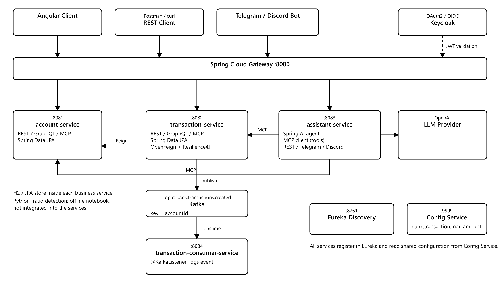

L'architecture ci-dessus est celle visée pour le projet. Elle est conçue pour être **résiliente**, **évolutive** et **centralisée** :

### Clients Externes
Application web Angular, client REST (Postman, curl) et bot Telegram / Discord qui consomment le système.

### Point d'Entrée (Spring Cloud Gateway)
Le seul point d'entrée pour toutes les requêtes. Il route vers les micro-services en consultant Eureka et gère le CORS pour le front Angular.

---

## Services d'Infrastructure

### Registry (Eureka Service)
L'annuaire où tous les micro-services s'enregistrent. Le Gateway et OpenFeign le consultent pour savoir où trouver les services.

### Config Service
Centralise la configuration partagée. Il expose le paramètre `bank.transaction.max-amount=1000`, lu par le transaction-service.

---

## Services Fonctionnels (Métier)

### Account Service & Transaction Service
Ils gèrent chacun leur logique métier et leur base H2. Chaque service expose la même couche `service` via **REST**, **GraphQL** et **MCP**.

### Communication inter-service
Le transaction-service appelle l'account-service via **OpenFeign**, protégé par un **Circuit Breaker Resilience4J**.

---

## Diagramme de classes

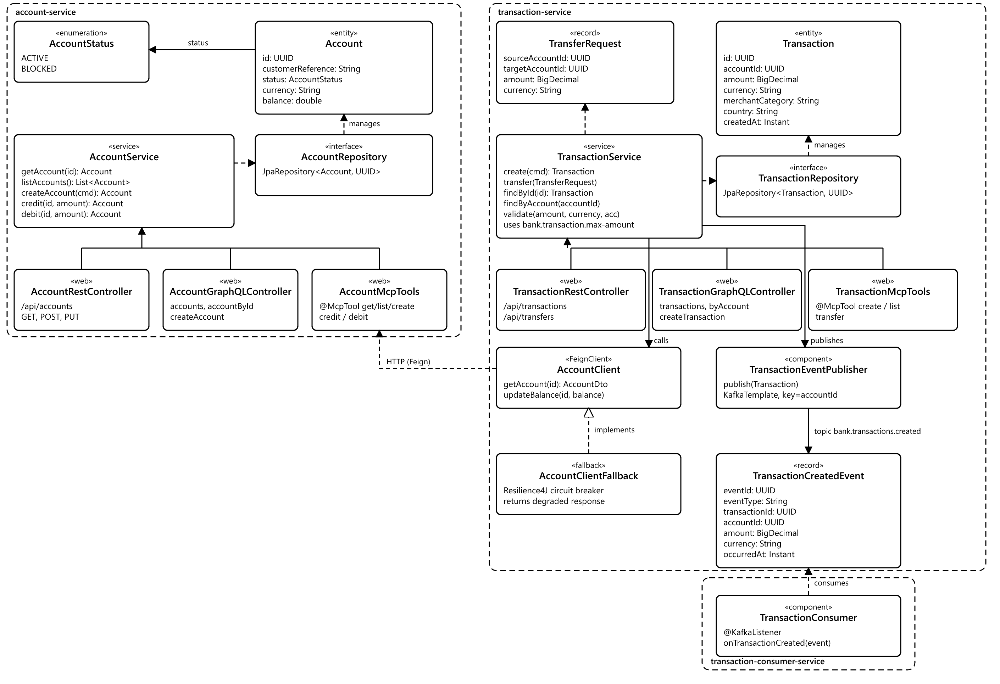

---

## Lancement

Ordre de démarrage : `discovery-service` (8761), `config-service` (9999), `account-service` (8081), `transaction-service` (8082), `gateway-service` (8080).

| Service | Port |
|---|---|
| gateway-service | 8080 |
| account-service | 8081 |
| transaction-service | 8082 |
| assistant-service | 8083 |
| transaction-consumer-service | 8084 |
| discovery-service | 8761 |
| config-service | 9999 |

---

# Développement et test des micro-services techniques

## Discovery-Service (Eureka)

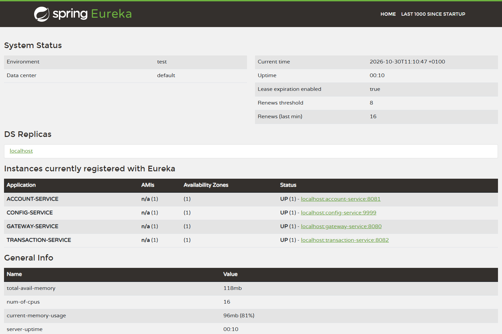

### Analyse du test

- Le service **DISCOVERY-SERVICE** est opérationnel sur le port **8761**.
- ACCOUNT-SERVICE, TRANSACTION-SERVICE, GATEWAY-SERVICE et CONFIG-SERVICE se sont **correctement enregistrés** auprès d'Eureka.

**Conclusion :** le service d'annuaire fonctionne et les micro-services s'y enregistrent et s'y découvrent.

---

## Gateway et Config Service

Le gateway expose des routes propres (`/api/accounts/**`, `/api/transactions/**`, `/api/transfers/**`) et les routes préfixées par le nom du service (`/account-service/...`). Toutes les requêtes des tests ci-dessous passent par `http://localhost:8080`.

Le config-service sert `bank.transaction.max-amount=1000` à tous les services. Le résultat est visible dans le test de la limite de montant plus bas.

---

# Développement et test des micro-services fonctionnels

## Account-Service

### REST

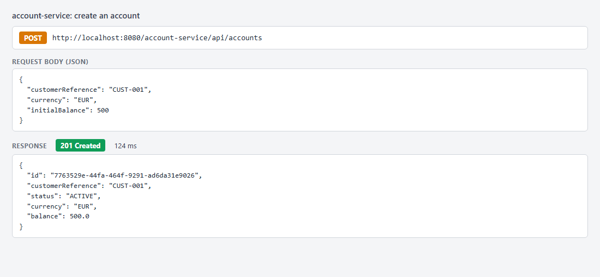

#### Analyse du test

- Requête POST envoyée à `http://localhost:8080/account-service/api/accounts`.
- Le gateway a routé la requête et le service a créé le compte avec le statut `ACTIVE` et un identifiant UUID.

**Conclusion :** statut **201 Created**. La chaîne *Gateway → Discovery → Service métier* fonctionne.

### GraphQL

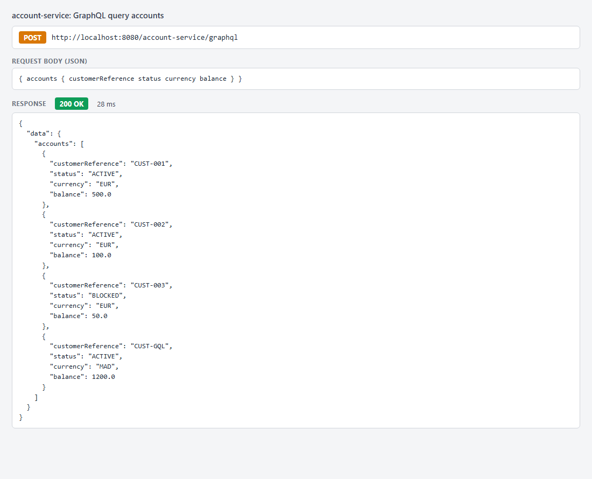

#### Analyse du test

- Requête GraphQL envoyée à `/account-service/graphql`.
- Seuls les champs demandés sont retournés.

**Conclusion :** le connecteur GraphQL appelle la même couche service que REST.

---

## Transaction-Service

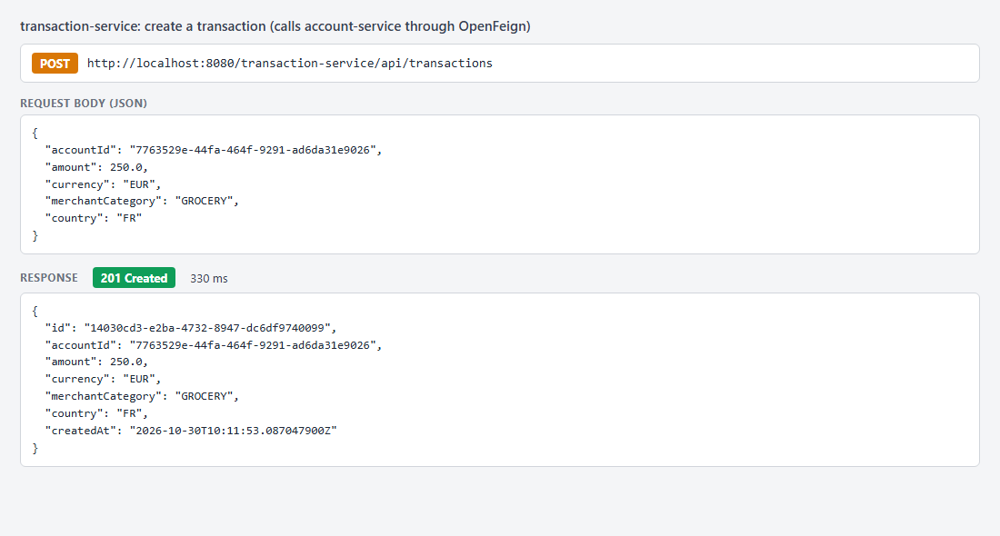

### Analyse du test

- Requête POST envoyée à `http://localhost:8080/transaction-service/api/transactions`.
- Le transaction-service appelle l'account-service via OpenFeign pour vérifier que le compte existe, qu'il est actif, que la devise correspond et que le solde suffit.
- La transaction est enregistrée, puis le compte est débité.

**Conclusion :** statut **201 Created**.

---

# Test de la Communication Inter-Service (OpenFeign et Resilience4J)

## Scénario Nominal (OpenFeign)

1. Un compte est créé avec un solde de 500 EUR.
2. Une transaction de 250 EUR est envoyée au transaction-service (image précédente).
3. Un GET sur l'account-service confirme la mise à jour du solde :

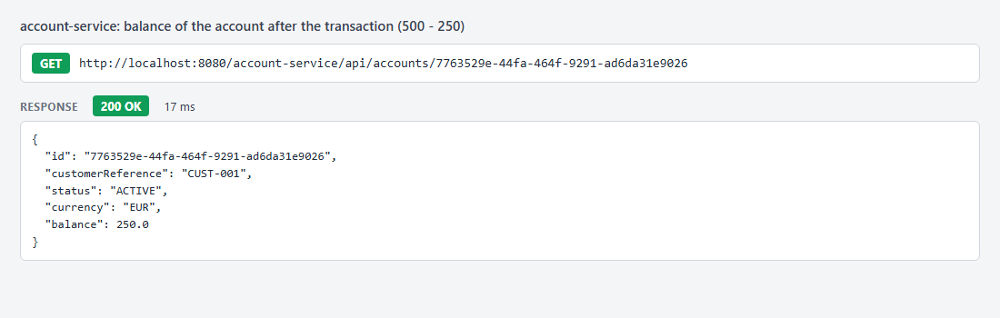

Le solde est passé de 500 à 250.

## Règle métier : montant maximum (Config Service)

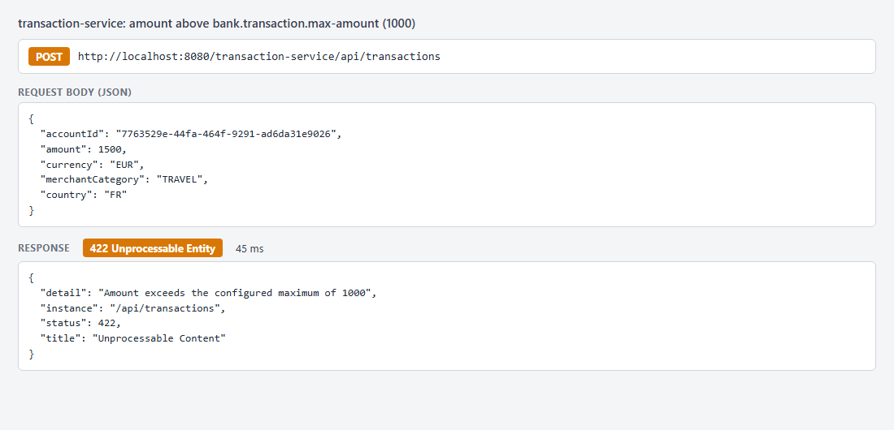

- Une transaction de 1500 est envoyée alors que `bank.transaction.max-amount=1000`.
- Le transaction-service lit cette valeur depuis le config-service et refuse la transaction.

**Conclusion :** statut **422**. La valeur est centralisée dans le config-service, et un changement de cette valeur (testé avec 500) est pris en compte après redémarrage.

## Virement entre deux comptes

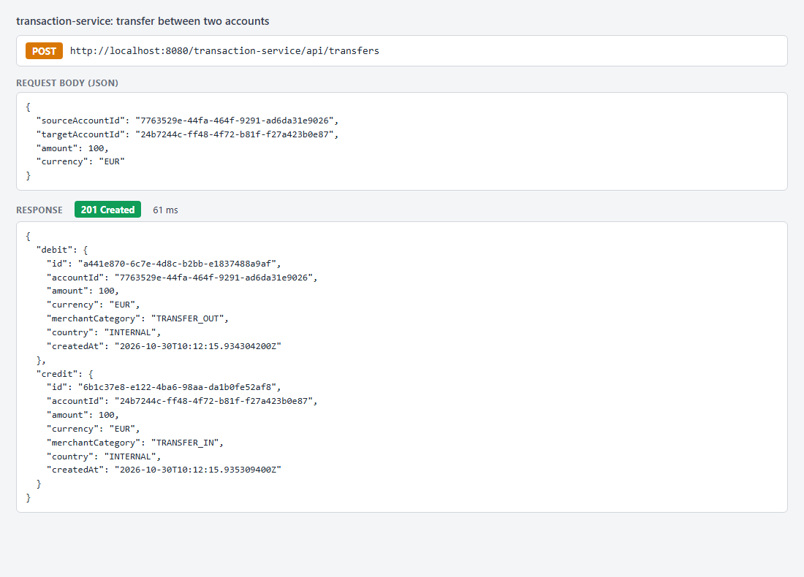

- Le virement crée deux transactions : `TRANSFER_OUT` sur le compte source et `TRANSFER_IN` sur le compte cible.
- Si le crédit du compte cible échoue, le compte source est recrédité.

**Conclusion :** statut **201 Created**.

---

## Scénario de Panne (Resilience4J)

1. Arrêter l'account-service.
2. Envoyer un POST au transaction-service.

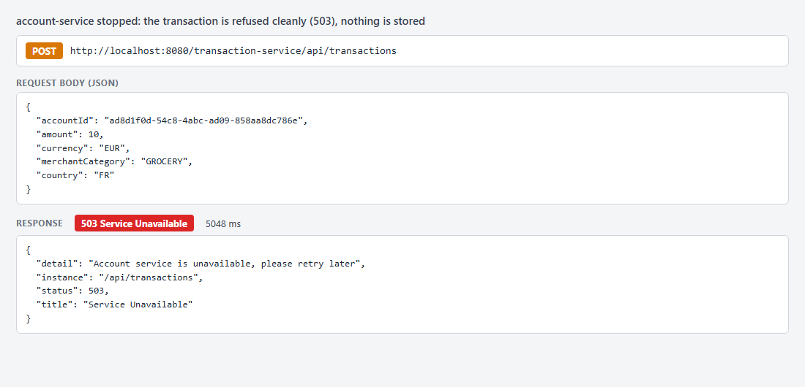

Le transaction-service répond **503 Service Unavailable** avec un message clair, et aucune transaction n'est enregistrée.

Après plusieurs échecs, le circuit passe à l'état **OPEN** : les appels suivants échouent immédiatement sans attendre le délai d'expiration.

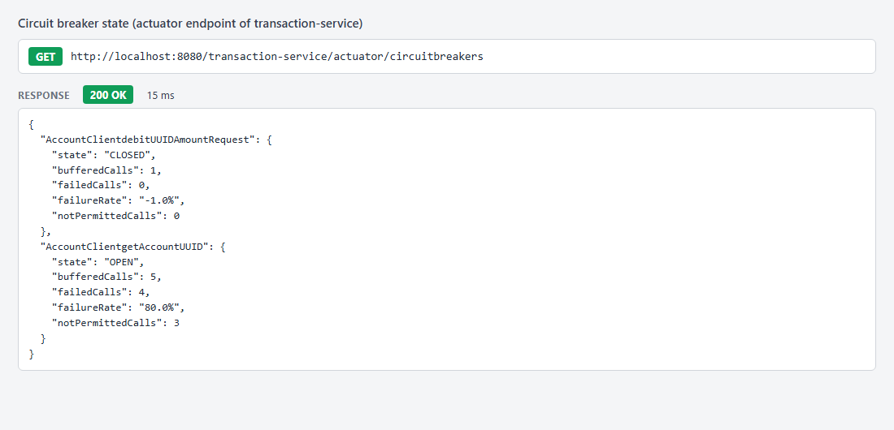

Une fois l'account-service redémarré, le circuit se referme et les transactions sont de nouveau acceptées :

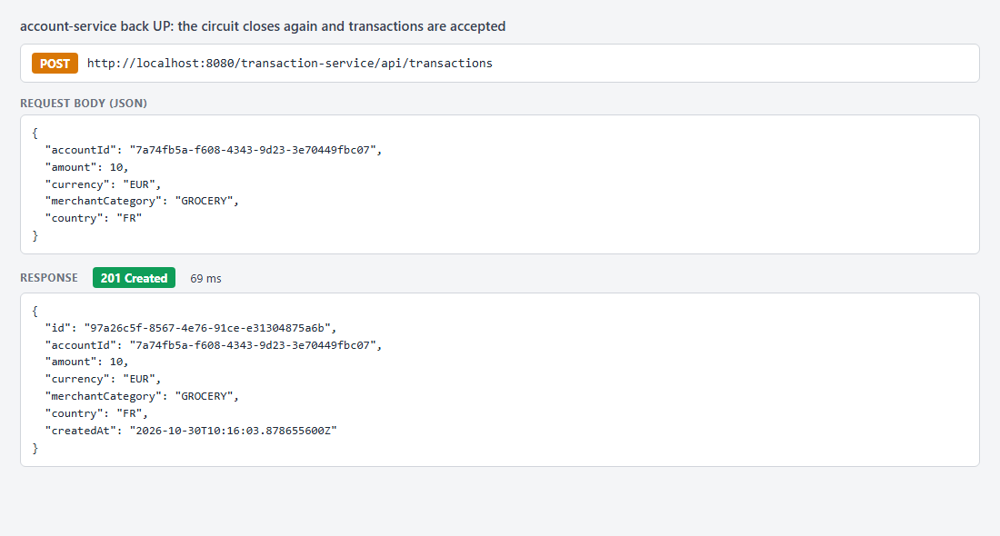

**Conclusion :** le système est **résilient** aux pannes d'un service en aval.

---

## Technologies

- **Spring Boot 4.1.1**, **Java 25**, Maven multi-modules
- **Spring Cloud** : Gateway, Netflix Eureka, Config Server, OpenFeign
- **Resilience4J** : Circuit Breaker et Time Limiter
- **Spring Data JPA** et **H2**
- **Spring GraphQL**
- **Spring AI** : serveur MCP
- **Angular 21** (initialisé)
